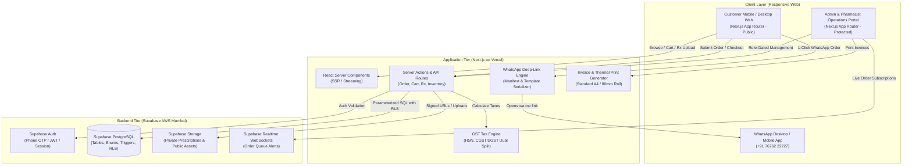
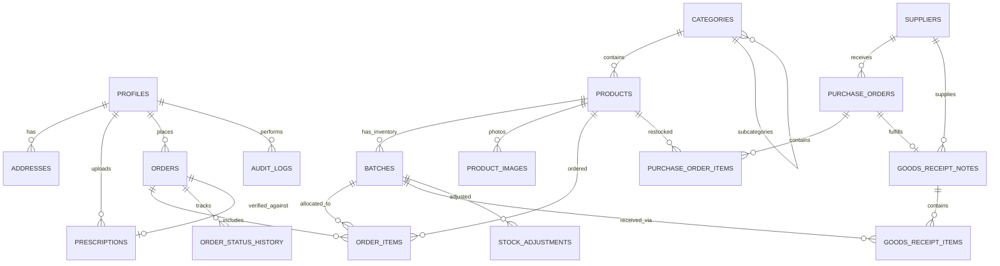
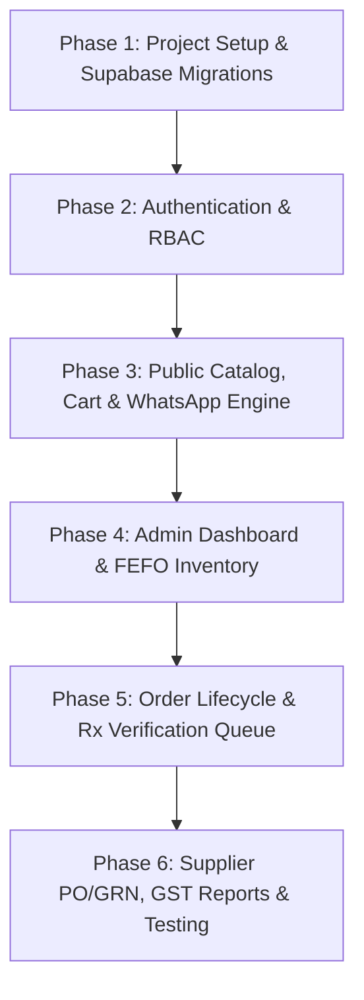

# System Architecture & Technical Design Document (Design.md)
## Maruthi Medical — E-Commerce & Pharmacy ERP Platform

---

### Executive Technical Overview

| Attribute | Specification |
| :--- | :--- |
| **System Name** | Maruthi Medical Omnichannel Commerce & Pharmacy ERP |
| **Frontend Framework** | **Next.js 14+ (App Router)**, React Server Components (RSC), TypeScript |
| **Styling & Design System** | Tailwind CSS + CSS Custom Properties, Radix UI Primitives, Lucide Icons |
| **Database & Auth** | **Supabase (PostgreSQL 15+)**, Supabase Auth, Row Level Security (RLS) |
| **Object Storage** | **Supabase Storage** (Private `prescriptions`, Public `product-images`, Private `invoices`) |
| **Realtime Sync** | Supabase Realtime (PostgreSQL CDC WebSockets) for live order counter |
| **State Management** | Zustand (Client-side Cart & Session) + TanStack Query / Server Actions |
| **WhatsApp Layer** | Deep-Link Engine (`wa.me` Protocol with URL Serialization, Zero Meta API Cost) |
| **Deployment Target** | Vercel Edge Network (Next.js) + Supabase Cloud (AWS ap-south-1 Mumbai) |
| **Print Engine** | Browser Print Media Stylesheets (80mm ESC/POS Thermal & A4 GST Invoice) |

---

### 1. High-Level System Architecture



---

### 2. Design System & Aesthetic Blueprint

Referencing the client's established prototype at `https://koppa-pharmacy-hub.preview.emergentagent.com/`, the application combines **warm apothecary heritage** with **modern, clean medical utility**.

#### 2.1 Color Palette & Theme Tokens

```css
:root {
  /* Brand Palette - Heritage Apothecary Meets Modern Clinical */
  --color-brand-primary: #0D3B2E;      /* Deep Forest Emerald: Header, Primary CTAs */
  --color-brand-secondary: #1F5A46;    /* Muted Bottle Green: Hover states, Cards */
  --color-brand-surface: #FBF9F5;      /* Warm Antique Parchment: Page Background */
  --color-brand-card: #FFFFFF;         /* Crisp White: Card containers */
  --color-brand-border: #E8E5DF;       /* Subtle Linen Border */
  
  /* Text & Typography */
  --color-text-main: #18221E;          /* Deep Obsidian Charcoal */
  --color-text-muted: #64746D;         /* Muted Slate Herb */
  --color-text-inverse: #FFFFFF;       /* Pure White */
  
  /* Accent & Accoutrements */
  --color-accent-amber: #C6923B;       /* Warm Apothecary Brass / Ochre */
  --color-accent-gold: #E5AD54;        /* Rating Stars & Badges */
  
  /* Status Indicators (Pharma Compliance) */
  --color-rx-badge: #7C2D12;           /* Deep Terracotta Red for Schedule H/H1 Rx */
  --color-rx-bg: #FEE2E2;              /* Light Rose Background */
  --color-otc-badge: #065F46;          /* Deep Mint Green for OTC */
  --color-otc-bg: #D1FAE5;             /* Mint Background */
  --color-expiry-alert: #DC2626;       /* Critical Expiry Alert (< 30 days) */
  --color-expiry-warning: #D97706;     /* Impending Expiry Warning (31-90 days) */
  --color-expiry-safe: #16A34A;        /* Safe Expiry (> 90 days) */
}
```

#### 2.2 Typography Hierarchy
- **Editorial Headings**: `font-serif` (Playfair Display or Cormorant Garamond) — Used for brand marks, chapter titles ("Maruthi Medical", "FIG. 001", "The Counter").
- **Body, UI & Data Tables**: `font-sans` (Plus Jakarta Sans or Inter) — Used for product catalogs, prices, stock figures, admin tables, and forms.
- **Monospace Elements**: `font-mono` (JetBrains Mono) — Used for Batch Numbers, Order IDs (`#MM-9821`), HSN codes, and Drug License numbers.

---

### 3. Database Architecture (Supabase PostgreSQL)

#### 3.1 Entity Relationship Diagram (ERD)



#### 3.2 Complete PostgreSQL Table Definitions & Enums

```sql
-- ============================================================================
-- 1. ENUMS & EXTENSIONS
-- ============================================================================
CREATE EXTENSION IF NOT EXISTS "uuid-ossp";
CREATE EXTENSION IF NOT EXISTS "pgcrypto";

CREATE TYPE user_role AS ENUM ('super_admin', 'admin', 'staff', 'customer');
CREATE TYPE drug_schedule AS ENUM ('otc', 'schedule_h', 'schedule_h1', 'schedule_x', 'ayurvedic');
CREATE TYPE dosage_form AS ENUM ('tablet', 'capsule', 'syrup', 'suspension', 'injection', 'ointment', 'drops', 'inhaler', 'powder', 'device');
CREATE TYPE prescription_status AS ENUM ('pending', 'approved', 'rejected');
CREATE TYPE order_status AS ENUM ('pending_review', 'confirmed', 'packing', 'out_for_delivery', 'ready_for_pickup', 'completed', 'cancelled', 'returned');
CREATE TYPE payment_status AS ENUM ('pending', 'paid', 'cod', 'refunded');
CREATE TYPE payment_method AS ENUM ('cod', 'upi_on_delivery', 'upi_prepaid', 'card', 'cash_counter');
CREATE TYPE order_source AS ENUM ('web', 'whatsapp', 'counter');
CREATE TYPE po_status AS ENUM ('draft', 'submitted', 'partially_received', 'received', 'cancelled');
CREATE TYPE adjustment_type AS ENUM ('breakage', 'expiry_disposal', 'audit_reconciliation', 'supplier_return');

-- ============================================================================
-- 2. USER PROFILES & ADDRESSES
-- ============================================================================
CREATE TABLE profiles (
    id UUID PRIMARY KEY REFERENCES auth.users(id) ON DELETE CASCADE,
    email TEXT UNIQUE,
    phone TEXT NOT NULL UNIQUE,
    full_name TEXT NOT NULL,
    role user_role NOT NULL DEFAULT 'customer',
    pharmacist_license_no TEXT, -- Only applicable if role is 'staff' or 'admin'
    created_at TIMESTAMPTZ NOT NULL DEFAULT NOW(),
    updated_at TIMESTAMPTZ NOT NULL DEFAULT NOW()
);

CREATE TABLE addresses (
    id UUID PRIMARY KEY DEFAULT gen_random_uuid(),
    user_id UUID NOT NULL REFERENCES profiles(id) ON DELETE CASCADE,
    recipient_name TEXT NOT NULL,
    phone TEXT NOT NULL,
    address_line1 TEXT NOT NULL,
    address_line2 TEXT,
    landmark TEXT,
    pincode VARCHAR(10) NOT NULL,
    city TEXT NOT NULL DEFAULT 'Bengaluru',
    state TEXT NOT NULL DEFAULT 'Karnataka',
    is_default BOOLEAN NOT NULL DEFAULT FALSE,
    created_at TIMESTAMPTZ NOT NULL DEFAULT NOW()
);

-- ============================================================================
-- 3. PRODUCT CATALOG
-- ============================================================================
CREATE TABLE categories (
    id UUID PRIMARY KEY DEFAULT gen_random_uuid(),
    name TEXT NOT NULL,
    slug TEXT NOT NULL UNIQUE,
    description TEXT,
    image_url TEXT,
    parent_id UUID REFERENCES categories(id) ON DELETE SET NULL,
    sort_order INT NOT NULL DEFAULT 0,
    is_active BOOLEAN NOT NULL DEFAULT TRUE,
    created_at TIMESTAMPTZ NOT NULL DEFAULT NOW()
);

CREATE TABLE products (
    id UUID PRIMARY KEY DEFAULT gen_random_uuid(),
    name TEXT NOT NULL,
    slug TEXT NOT NULL UNIQUE,
    brand_manufacturer TEXT NOT NULL,
    generic_salt TEXT,
    category_id UUID REFERENCES categories(id) ON DELETE SET NULL,
    drug_schedule drug_schedule NOT NULL DEFAULT 'otc',
    dosage_form dosage_form NOT NULL DEFAULT 'tablet',
    pack_size TEXT NOT NULL, -- e.g. "Strip of 15 Tablets", "100ml Bottle"
    hsn_code VARCHAR(12) NOT NULL DEFAULT '3004',
    gst_percentage NUMERIC(5, 2) NOT NULL DEFAULT 12.00,
    prescription_required BOOLEAN NOT NULL DEFAULT FALSE,
    description TEXT,
    side_effects TEXT,
    storage_instructions TEXT,
    safety_stock_threshold INT NOT NULL DEFAULT 10,
    is_featured BOOLEAN NOT NULL DEFAULT FALSE,
    is_active BOOLEAN NOT NULL DEFAULT TRUE,
    created_at TIMESTAMPTZ NOT NULL DEFAULT NOW(),
    updated_at TIMESTAMPTZ NOT NULL DEFAULT NOW()
);

CREATE TABLE product_images (
    id UUID PRIMARY KEY DEFAULT gen_random_uuid(),
    product_id UUID NOT NULL REFERENCES products(id) ON DELETE CASCADE,
    image_url TEXT NOT NULL,
    alt_text TEXT,
    display_order INT NOT NULL DEFAULT 0
);

-- ============================================================================
-- 4. INVENTORY & BATCH MANAGEMENT (FEFO Engine)
-- ============================================================================
CREATE TABLE batches (
    id UUID PRIMARY KEY DEFAULT gen_random_uuid(),
    product_id UUID NOT NULL REFERENCES products(id) ON DELETE RESTRICT,
    batch_number VARCHAR(64) NOT NULL,
    manufacturing_date DATE,
    expiry_date DATE NOT NULL,
    purchase_price NUMERIC(10, 2) NOT NULL, -- Exclusive of GST
    mrp NUMERIC(10, 2) NOT NULL,            -- Maximum Retail Price (Inclusive of GST)
    sale_price NUMERIC(10, 2) NOT NULL,     -- Actual Selling Price after store discount
    stock_quantity INT NOT NULL DEFAULT 0 CHECK (stock_quantity >= 0),
    reserved_quantity INT NOT NULL DEFAULT 0 CHECK (reserved_quantity >= 0),
    rack_location VARCHAR(32),              -- e.g. "Rack-A3-Shelf2"
    is_quarantined BOOLEAN NOT NULL DEFAULT FALSE,
    created_at TIMESTAMPTZ NOT NULL DEFAULT NOW(),
    updated_at TIMESTAMPTZ NOT NULL DEFAULT NOW(),
    UNIQUE(product_id, batch_number)
);

-- ============================================================================
-- 5. PRESCRIPTIONS
-- ============================================================================
CREATE TABLE prescriptions (
    id UUID PRIMARY KEY DEFAULT gen_random_uuid(),
    user_id UUID REFERENCES profiles(id) ON DELETE SET NULL,
    file_path TEXT NOT NULL,
    file_type VARCHAR(16) NOT NULL,
    patient_name TEXT,
    doctor_name TEXT,
    notes TEXT,
    status prescription_status NOT NULL DEFAULT 'pending',
    verified_by UUID REFERENCES profiles(id) ON DELETE SET NULL,
    verified_at TIMESTAMPTZ,
    rejection_reason TEXT,
    created_at TIMESTAMPTZ NOT NULL DEFAULT NOW()
);

-- ============================================================================
-- 6. ORDERS & FULFILLMENT
-- ============================================================================
CREATE TABLE orders (
    id UUID PRIMARY KEY DEFAULT gen_random_uuid(),
    order_number VARCHAR(32) NOT NULL UNIQUE, -- e.g. "MM-202610-0012"
    user_id UUID REFERENCES profiles(id) ON DELETE SET NULL,
    customer_name TEXT NOT NULL,
    customer_phone TEXT NOT NULL,
    delivery_type VARCHAR(16) NOT NULL DEFAULT 'delivery', -- 'delivery' or 'pickup'
    address_id UUID REFERENCES addresses(id) ON DELETE SET NULL,
    delivery_address_json JSONB, -- Frozen snapshot of delivery address
    prescription_id UUID REFERENCES prescriptions(id) ON DELETE SET NULL,
    
    subtotal NUMERIC(10, 2) NOT NULL,
    discount_amount NUMERIC(10, 2) NOT NULL DEFAULT 0.00,
    delivery_fee NUMERIC(10, 2) NOT NULL DEFAULT 0.00,
    tax_amount NUMERIC(10, 2) NOT NULL DEFAULT 0.00,
    total_amount NUMERIC(10, 2) NOT NULL,
    
    payment_status payment_status NOT NULL DEFAULT 'pending',
    payment_method payment_method NOT NULL DEFAULT 'cod',
    order_status order_status NOT NULL DEFAULT 'pending_review',
    placed_via order_source NOT NULL DEFAULT 'web',
    
    customer_notes TEXT,
    admin_notes TEXT,
    created_at TIMESTAMPTZ NOT NULL DEFAULT NOW(),
    updated_at TIMESTAMPTZ NOT NULL DEFAULT NOW()
);

CREATE TABLE order_items (
    id UUID PRIMARY KEY DEFAULT gen_random_uuid(),
    order_id UUID NOT NULL REFERENCES orders(id) ON DELETE CASCADE,
    product_id UUID NOT NULL REFERENCES products(id) ON DELETE RESTRICT,
    batch_id UUID REFERENCES batches(id) ON DELETE RESTRICT,
    product_name TEXT NOT NULL,
    batch_number VARCHAR(64),
    expiry_date DATE,
    hsn_code VARCHAR(12) NOT NULL,
    quantity INT NOT NULL CHECK (quantity > 0),
    unit_price NUMERIC(10, 2) NOT NULL,
    gst_percentage NUMERIC(5, 2) NOT NULL,
    cgst_amount NUMERIC(10, 2) NOT NULL,
    sgst_amount NUMERIC(10, 2) NOT NULL,
    total_amount NUMERIC(10, 2) NOT NULL
);

CREATE TABLE order_status_history (
    id UUID PRIMARY KEY DEFAULT gen_random_uuid(),
    order_id UUID NOT NULL REFERENCES orders(id) ON DELETE CASCADE,
    previous_status order_status,
    new_status order_status NOT NULL,
    changed_by UUID REFERENCES profiles(id) ON DELETE SET NULL,
    notes TEXT,
    created_at TIMESTAMPTZ NOT NULL DEFAULT NOW()
);

-- ============================================================================
-- 7. ABANDONED CARTS
-- ============================================================================
CREATE TABLE abandoned_carts (
    id UUID PRIMARY KEY DEFAULT gen_random_uuid(),
    session_id TEXT NOT NULL,
    user_id UUID REFERENCES profiles(id) ON DELETE SET NULL,
    customer_phone TEXT,
    customer_name TEXT,
    cart_items_json JSONB NOT NULL,
    total_value NUMERIC(10, 2) NOT NULL,
    last_activity TIMESTAMPTZ NOT NULL DEFAULT NOW(),
    whatsapp_reminder_sent BOOLEAN NOT NULL DEFAULT FALSE,
    reminder_sent_at TIMESTAMPTZ,
    recovered_order_id UUID REFERENCES orders(id) ON DELETE SET NULL
);

-- ============================================================================
-- 8. SUPPLIERS & PROCUREMENT (PO & GRN)
-- ============================================================================
CREATE TABLE suppliers (
    id UUID PRIMARY KEY DEFAULT gen_random_uuid(),
    name TEXT NOT NULL,
    company_name TEXT NOT NULL,
    gstin VARCHAR(15),
    drug_license_numbers TEXT,
    phone TEXT NOT NULL,
    email TEXT,
    address TEXT,
    payment_terms_days INT NOT NULL DEFAULT 21,
    is_active BOOLEAN NOT NULL DEFAULT TRUE,
    created_at TIMESTAMPTZ NOT NULL DEFAULT NOW()
);

CREATE TABLE purchase_orders (
    id UUID PRIMARY KEY DEFAULT gen_random_uuid(),
    po_number VARCHAR(32) NOT NULL UNIQUE, -- e.g. "PO-202610-0004"
    supplier_id UUID NOT NULL REFERENCES suppliers(id) ON DELETE RESTRICT,
    status po_status NOT NULL DEFAULT 'draft',
    total_estimated_amount NUMERIC(12, 2) NOT NULL DEFAULT 0.00,
    notes TEXT,
    created_by UUID REFERENCES profiles(id) ON DELETE SET NULL,
    created_at TIMESTAMPTZ NOT NULL DEFAULT NOW(),
    updated_at TIMESTAMPTZ NOT NULL DEFAULT NOW()
);

CREATE TABLE purchase_order_items (
    id UUID PRIMARY KEY DEFAULT gen_random_uuid(),
    po_id UUID NOT NULL REFERENCES purchase_orders(id) ON DELETE CASCADE,
    product_id UUID NOT NULL REFERENCES products(id) ON DELETE RESTRICT,
    quantity_ordered INT NOT NULL CHECK (quantity_ordered > 0),
    estimated_unit_cost NUMERIC(10, 2) NOT NULL
);

CREATE TABLE goods_receipt_notes (
    id UUID PRIMARY KEY DEFAULT gen_random_uuid(),
    grn_number VARCHAR(32) NOT NULL UNIQUE, -- e.g. "GRN-202610-0009"
    po_id UUID REFERENCES purchase_orders(id) ON DELETE SET NULL,
    supplier_id UUID NOT NULL REFERENCES suppliers(id) ON DELETE RESTRICT,
    supplier_invoice_no VARCHAR(64) NOT NULL,
    supplier_invoice_date DATE NOT NULL,
    total_taxable NUMERIC(12, 2) NOT NULL,
    total_tax NUMERIC(12, 2) NOT NULL,
    grand_total NUMERIC(12, 2) NOT NULL,
    received_by UUID REFERENCES profiles(id) ON DELETE SET NULL,
    created_at TIMESTAMPTZ NOT NULL DEFAULT NOW()
);

CREATE TABLE goods_receipt_items (
    id UUID PRIMARY KEY DEFAULT gen_random_uuid(),
    grn_id UUID NOT NULL REFERENCES goods_receipt_notes(id) ON DELETE CASCADE,
    product_id UUID NOT NULL REFERENCES products(id) ON DELETE RESTRICT,
    batch_number VARCHAR(64) NOT NULL,
    manufacturing_date DATE,
    expiry_date DATE NOT NULL,
    received_quantity INT NOT NULL CHECK (received_quantity >= 0),
    free_quantity INT NOT NULL DEFAULT 0 CHECK (free_quantity >= 0),
    purchase_rate NUMERIC(10, 2) NOT NULL,
    mrp NUMERIC(10, 2) NOT NULL,
    sale_price NUMERIC(10, 2) NOT NULL,
    gst_percentage NUMERIC(5, 2) NOT NULL,
    total_amount NUMERIC(12, 2) NOT NULL
);

-- ============================================================================
-- 9. AUDIT LOGS & STOCK ADJUSTMENTS
-- ============================================================================
CREATE TABLE stock_adjustments (
    id UUID PRIMARY KEY DEFAULT gen_random_uuid(),
    product_id UUID NOT NULL REFERENCES products(id) ON DELETE RESTRICT,
    batch_id UUID NOT NULL REFERENCES batches(id) ON DELETE RESTRICT,
    adjustment_type adjustment_type NOT NULL,
    quantity_changed INT NOT NULL, -- Negative for disposal/loss, positive for audit surplus
    reason TEXT NOT NULL,
    adjusted_by UUID REFERENCES profiles(id) ON DELETE SET NULL,
    created_at TIMESTAMPTZ NOT NULL DEFAULT NOW()
);

CREATE TABLE audit_logs (
    id UUID PRIMARY KEY DEFAULT gen_random_uuid(),
    user_id UUID REFERENCES profiles(id) ON DELETE SET NULL,
    action TEXT NOT NULL,
    entity_type TEXT NOT NULL,
    entity_id UUID,
    old_data JSONB,
    new_data JSONB,
    ip_address TEXT,
    created_at TIMESTAMPTZ NOT NULL DEFAULT NOW()
);
```

#### 3.3 Database Triggers & Automations

##### 1. Stock Deduction on Order Allocation & Restoration on Cancellation
```sql
CREATE OR REPLACE FUNCTION handle_order_status_inventory_sync()
RETURNS TRIGGER AS $$
BEGIN
    -- When order moves to 'packing' or 'confirmed', verify and deduct batch stock
    IF NEW.order_status IN ('confirmed', 'packing') AND OLD.order_status = 'pending_review' THEN
        -- Loop through order items and deduct stock
        UPDATE batches b
        SET stock_quantity = b.stock_quantity - oi.quantity,
            updated_at = NOW()
        FROM order_items oi
        WHERE oi.order_id = NEW.id AND oi.batch_id = b.id;
    END IF;

    -- If order is cancelled after being confirmed/packed, restore stock
    IF NEW.order_status = 'cancelled' AND OLD.order_status IN ('confirmed', 'packing', 'out_for_delivery') THEN
        UPDATE batches b
        SET stock_quantity = b.stock_quantity + oi.quantity,
            updated_at = NOW()
        FROM order_items oi
        WHERE oi.order_id = NEW.id AND oi.batch_id = b.id;
    END IF;

    RETURN NEW;
END;
$$ LANGUAGE plpgsql;

CREATE TRIGGER trg_order_inventory_sync
AFTER UPDATE OF order_status ON orders
FOR EACH ROW
EXECUTE FUNCTION handle_order_status_inventory_sync();
```

##### 2. Auto-Inwarding Batches from Goods Receipt Note (GRN)
```sql
CREATE OR REPLACE FUNCTION sync_grn_items_to_batches()
RETURNS TRIGGER AS $$
BEGIN
    INSERT INTO batches (
        product_id,
        batch_number,
        manufacturing_date,
        expiry_date,
        purchase_price,
        mrp,
        sale_price,
        stock_quantity
    ) VALUES (
        NEW.product_id,
        NEW.batch_number,
        NEW.manufacturing_date,
        NEW.expiry_date,
        NEW.purchase_rate,
        NEW.mrp,
        NEW.sale_price,
        NEW.received_quantity + NEW.free_quantity
    )
    ON CONFLICT (product_id, batch_number)
    DO UPDATE SET
        stock_quantity = batches.stock_quantity + (NEW.received_quantity + NEW.free_quantity),
        purchase_price = NEW.purchase_rate,
        mrp = NEW.mrp,
        sale_price = NEW.sale_price,
        expiry_date = NEW.expiry_date,
        updated_at = NOW();

    RETURN NEW;
END;
$$ LANGUAGE plpgsql;

CREATE TRIGGER trg_grn_item_insert
AFTER INSERT ON goods_receipt_items
FOR EACH ROW
EXECUTE FUNCTION sync_grn_items_to_batches();
```

---

### 4. Row Level Security (RLS) & Access Control Matrix

```sql
-- Enable RLS across all core tables
ALTER TABLE profiles ENABLE ROW LEVEL SECURITY;
ALTER TABLE addresses ENABLE ROW LEVEL SECURITY;
ALTER TABLE products ENABLE ROW LEVEL SECURITY;
ALTER TABLE batches ENABLE ROW LEVEL SECURITY;
ALTER TABLE prescriptions ENABLE ROW LEVEL SECURITY;
ALTER TABLE orders ENABLE ROW LEVEL SECURITY;
ALTER TABLE order_items ENABLE ROW LEVEL SECURITY;
ALTER TABLE suppliers ENABLE ROW LEVEL SECURITY;
ALTER TABLE purchase_orders ENABLE ROW LEVEL SECURITY;
ALTER TABLE goods_receipt_notes ENABLE ROW LEVEL SECURITY;
ALTER TABLE abandoned_carts ENABLE ROW LEVEL SECURITY;

-- Helper function to extract user role from profiles table
CREATE OR REPLACE FUNCTION get_user_role(uid UUID)
RETURNS user_role AS $$
  SELECT role FROM profiles WHERE id = uid;
$$ LANGUAGE sql SECURITY DEFINER STABLE;

-- 1. Profiles: Users can view & edit their own profile; Staff/Admin can view all
CREATE POLICY "Profiles view self or staff" ON profiles
FOR SELECT USING (auth.uid() = id OR get_user_role(auth.uid()) IN ('staff', 'admin', 'super_admin'));

CREATE POLICY "Profiles update self" ON profiles
FOR UPDATE USING (auth.uid() = id);

-- 2. Products & Categories: Public read access; Staff/Admin modify
CREATE POLICY "Public read active products" ON products
FOR SELECT USING (is_active = TRUE OR get_user_role(auth.uid()) IN ('staff', 'admin', 'super_admin'));

CREATE POLICY "Staff modify products" ON products
FOR ALL USING (get_user_role(auth.uid()) IN ('staff', 'admin', 'super_admin'));

-- 3. Batches: Staff/Admin have full access; Customers only read sale price/availability
CREATE POLICY "Public read batch prices" ON batches
FOR SELECT USING (is_quarantined = FALSE AND stock_quantity > 0);

CREATE POLICY "Staff manage batches" ON batches
FOR ALL USING (get_user_role(auth.uid()) IN ('staff', 'admin', 'super_admin'));

-- 4. Prescriptions: Customer view/upload own; Staff/Admin full access
CREATE POLICY "Customer view own rx" ON prescriptions
FOR SELECT USING (auth.uid() = user_id OR get_user_role(auth.uid()) IN ('staff', 'admin', 'super_admin'));

CREATE POLICY "Customer upload rx" ON prescriptions
FOR INSERT WITH CHECK (auth.uid() = user_id OR user_id IS NULL);

CREATE POLICY "Staff update rx verification" ON prescriptions
FOR UPDATE USING (get_user_role(auth.uid()) IN ('staff', 'admin', 'super_admin'));

-- 5. Orders: Customer view own; Staff/Admin full access
CREATE POLICY "Customer view own orders" ON orders
FOR SELECT USING (auth.uid() = user_id OR get_user_role(auth.uid()) IN ('staff', 'admin', 'super_admin'));

CREATE POLICY "Customer create order" ON orders
FOR INSERT WITH CHECK (auth.uid() = user_id OR user_id IS NULL);

CREATE POLICY "Staff manage all orders" ON orders
FOR ALL USING (get_user_role(auth.uid()) IN ('staff', 'admin', 'super_admin'));

-- 6. Suppliers & Procurement: Restricted strictly to Admin and Super Admin
CREATE POLICY "Admin manage suppliers" ON suppliers
FOR ALL USING (get_user_role(auth.uid()) IN ('admin', 'super_admin'));

CREATE POLICY "Admin manage PO and GRN" ON purchase_orders
FOR ALL USING (get_user_role(auth.uid()) IN ('admin', 'super_admin'));
```

---

### 5. Storage Buckets & Media Security Architecture

| Bucket Name | Access Level | Allowed MIME Types | Max Size | RLS Policy |
| :--- | :--- | :--- | :--- | :--- |
| `prescriptions` | **Private** | `image/jpeg`, `image/png`, `image/webp`, `application/pdf` | 10 MB | Read restricted to uploading customer + Staff/Admin roles. URLs served via 15-minute Supabase Signed URLs (`createSignedUrl`). |
| `product-images` | **Public** | `image/jpeg`, `image/png`, `image/webp` | 5 MB | Public read access via CDN; write restricted to Staff/Admin. |
| `invoices` | **Private** | `application/pdf` | 15 MB | Generated GST invoices. Read restricted to order owner + Staff/Admin. |

---

### 6. WhatsApp Deep-Link Engine (Zero API Cost Protocol)

Rather than paying per-conversation fees to Meta Cloud API, the application features an advanced client/server-side message serialisation engine that generates RFC 3986 URL-encoded links.

#### 6.1 WhatsApp Deep-Link URL Generator Implementation

```typescript
// lib/whatsapp/encoder.ts

export interface WhatsAppOrderManifest {
  orderNumber?: string;
  customerName: string;
  customerPhone: string;
  deliveryAddress: string;
  items: Array<{
    name: string;
    packSize: string;
    quantity: number;
    price: number;
  }>;
  subtotal: number;
  deliveryFee: number;
  total: number;
  prescriptionUrl?: string;
  customerNotes?: string;
}

export function generateWhatsAppOrderLink(
  manifest: WhatsAppOrderManifest,
  storePhone: string = "917676222727"
): string {
  const lines: string[] = [];

  lines.push("🌿 *NEW ORDER — MARUTHI MEDICAL* 🌿");
  lines.push("📍 _Shop 7, Koppa Village, Bengaluru 560105_");
  lines.push("----------------------------------------");
  if (manifest.orderNumber) {
    lines.push(`*Order No:* #${manifest.orderNumber}`);
  }
  lines.push(`*Customer:* ${manifest.customerName}`);
  lines.push(`*Phone:* ${manifest.customerPhone}`);
  lines.push(`*Address:* ${manifest.deliveryAddress}`);
  lines.push("----------------------------------------");
  lines.push("*ORDERED MEDICINES & SUPPLIES:*");

  manifest.items.forEach((item, index) => {
    lines.push(
      `${index + 1}. *${item.name}* (${item.packSize})\n   Qty: ${item.quantity} × ₹${item.price.toFixed(2)} = ₹${(item.quantity * item.price).toFixed(2)}`
    );
  });

  lines.push("----------------------------------------");
  lines.push(`*Items Total:* ₹${manifest.subtotal.toFixed(2)}`);
  lines.push(
    `*Delivery:* ${manifest.deliveryFee === 0 ? "FREE (Koppa Local)" : `₹${manifest.deliveryFee.toFixed(2)}`}`
  );
  lines.push(`*ESTIMATED TOTAL:* ₹${manifest.total.toFixed(2)}`);

  if (manifest.prescriptionUrl) {
    lines.push("----------------------------------------");
    lines.push(`📎 *Doctor's Prescription Attached:*`);
    lines.push(manifest.prescriptionUrl);
  }

  if (manifest.customerNotes) {
    lines.push("----------------------------------------");
    lines.push(`💬 *Customer Note:* "${manifest.customerNotes}"`);
  }

  lines.push("----------------------------------------");
  lines.push("Please confirm stock availability and dispatch time. Thank you!");

  const rawMessage = lines.join("\n");
  const encodedMessage = encodeURIComponent(rawMessage);

  return `https://wa.me/${storePhone}?text=${encodedMessage}`;
}

/**
 * 1-Click WhatsApp Abandoned Cart Recovery Link Generator
 */
export function generateAbandonedCartRecoveryLink(params: {
  customerName: string;
  customerPhone: string;
  cartItemSummary: string;
  cartValue: number;
  recoveryUrl: string;
}): string {
  const text = 
    `Hello ${params.customerName}! 👋\n\n` +
    `We noticed you left ${params.cartItemSummary} (worth ₹${params.cartValue.toFixed(2)}) in your cart at *Maruthi Medical, Koppa Village*.\n\n` +
    `Would you like us to pack your medicines for prompt doorstep delivery today?\n\n` +
    `👉 *Click here to complete your order in 1 tap:* ${params.recoveryUrl}\n\n` +
    `Or reply to this message directly and our pharmacist will assist you! 🌿`;

  const phone = params.customerPhone.replace(/\D/g, "");
  const formattedPhone = phone.startsWith("91") ? phone : `91${phone}`;

  return `https://wa.me/${formattedPhone}?text=${encodeURIComponent(text)}`;
}
```

---

### 7. Frontend Architecture & Directory Layout

```
Maruthi/
├── app/
│   ├── (public)/                       # Public-Facing Consumer Experience
│   │   ├── page.tsx                    # Aesthetic Home Page (Chapters, Hero, Marquee, Quick Services)
│   │   ├── catalog/                    # Medicine & OTC Catalog
│   │   │   ├── page.tsx                # Instant Search, Categories, Generic Salt Filters
│   │   │   └── [slug]/page.tsx         # Product Detail Page (Dosage, Rx Warning, Salt Composition)
│   │   ├── cart/                       # Cart Overview & Prescription Upload Step
│   │   │   └── page.tsx
│   │   ├── checkout/                   # Address & Payment Options (COD, UPI, WhatsApp Order)
│   │   │   └── page.tsx
│   │   ├── order-success/              # Order Confirmation + Share to WhatsApp Manifest
│   │   │   └── [orderId]/page.tsx
│   │   ├── track/                      # Live Order Tracking by Order Number
│   │   │   └── [orderNumber]/page.tsx
│   │   └── contact/                    # Store Location (Koppa Village Map, Hours, Phone)
│   │       └── page.tsx
│   ├── (auth)/                         # Authentication Routes
│   │   ├── login/page.tsx              # Phone OTP / Password Login
│   │   └── register/page.tsx
│   ├── admin/                          # Gated Operations & Pharmacy ERP
│   │   ├── layout.tsx                  # Admin Shell (Sidebar, Notification Bell, User Switcher)
│   │   ├── page.tsx                    # Executive KPI Dashboard & Real-Time Sales
│   │   ├── products/                   # Product Catalog Management
│   │   │   ├── page.tsx                # Searchable Data Table with Rx Badges
│   │   │   ├── new/page.tsx            # Product Creation Form
│   │   │   └── [id]/edit/page.tsx
│   │   ├── inventory/                  # Batch & FEFO Stock Management
│   │   │   ├── page.tsx                # Batches List, Expiry Alert Grid, Rack Locations
│   │   │   └── adjustments/page.tsx    # Stock Reconciliation & Expiry Write-Offs
│   │   ├── orders/                     # End-to-End Order Lifecycle
│   │   │   ├── page.tsx                # Kanban & Table Pipeline (Pending, Packed, Out)
│   │   │   └── [id]/page.tsx           # Split-Screen Rx Verification & Invoice Generator
│   │   ├── abandoned-carts/            # Abandoned Cart Recovery Workspace
│   │   │   └── page.tsx                # Dropped Sessions + 1-Click WhatsApp Trigger
│   │   ├── customers/                  # Customer CRM & Chronic Care Refills
│   │   │   ├── page.tsx
│   │   │   └── [id]/page.tsx           # Customer 360 & Historical Prescriptions
│   │   ├── suppliers/                  # Supplier Directory & Procurement
│   │   │   ├── page.tsx                # Vendors List & Credit Ledgers
│   │   │   ├── purchase-orders/page.tsx # PO Creation & Drafts
│   │   │   └── grn/page.tsx            # Goods Receipt Note Inwarding with Batch Entry
│   │   ├── reports/                    # Financial & GST Statutory Reporting
│   │   │   ├── sales/page.tsx          # Gross Revenue, Profit Margins, Payment Modes
│   │   │   └── gst/page.tsx            # GSTR-1 Taxable Value & CGST/SGST Slabs
│   │   └── users/                      # Staff & Role Management (Super Admin only)
│   │       └── page.tsx
│   └── api/                            # Backend Handlers & Webhooks
│       ├── print/invoice/[id]/route.ts # Server-side HTML/PDF Invoice Stream
│       └── webhooks/payment/route.ts   # Razorpay/UPI Payment Verification
├── components/
│   ├── public/                         # Public Storefront Components
│   │   ├── Navbar.tsx
│   │   ├── Footer.tsx
│   │   ├── ChapterSection.tsx          # Aesthetic Storytelling Section
│   │   ├── ProductCard.tsx             # OTC vs Rx Badged Card
│   │   ├── PrescriptionUploader.tsx    # Camera & PDF Drag-and-Drop
│   │   ├── CartDrawer.tsx
│   │   └── WhatsAppOrderButton.tsx     # Deep-Link Launcher
│   ├── admin/                          # Admin ERP Components
│   │   ├── AdminSidebar.tsx
│   │   ├── KpiCard.tsx
│   │   ├── ExpiryBadge.tsx             # Red (<30d), Amber (31-90d), Green (>90d)
│   │   ├── RxVerificationModal.tsx     # Zoomable Prescription Viewer + Order Item Adjuster
│   │   ├── ThermalPrintView.tsx        # 80mm ESC/POS Styling
│   │   └── BatchSelector.tsx           # FEFO Auto-Suggest Dropdown
│   └── ui/                             # Radix UI Primitives (Modal, Select, Toast, Tabs)
├── lib/
│   ├── supabase/
│   │   ├── client.ts                   # Browser Supabase Client
│   │   ├── server.ts                   # RSC Server Client with Cookies
│   │   └── admin.ts                    # Service Role Client (Bypasses RLS for System Tasks)
│   ├── whatsapp/
│   │   └── encoder.ts                  # URL Serializer & Pre-Formatted Manifests
│   ├── tax/
│   │   └── gstCalculator.ts            # HSN & CGST/SGST Split Logic
│   └── stores/
│       └── useCartStore.ts             # Zustand Cart with LocalStorage Hydration
└── styles/
    └── globals.css                     # Tailwind Base, Apothecary Palette & Print Styles
```

---

### 8. GST Calculation Engine & Indian Pharmacy Tax Model

Pharmaceutical retail billing under Indian GST law operates under strict dual-tax rates (CGST + SGST) determined by HSN codes:
- **HSN 3004 (Medicaments)**: 12% GST (6% CGST + 6% SGST).
- **HSN 3005 (Bandages, Dressings, Cotton)**: 12% GST (6% CGST + 6% SGST).
- **HSN 9018/9025 (Medical Equipment, Thermometers)**: 18% GST (9% CGST + 9% SGST).
- **HSN 2106 (Nutritional/Ayurvedic food supplements)**: 18% GST (9% CGST + 9% SGST).
- **Sanitary & Certain Life-Saving Formulations**: 5% GST (2.5% CGST + 2.5% SGST) or 0% Exempt.

#### 8.1 GST Engine Implementation (`lib/tax/gstCalculator.ts`)

```typescript
export interface TaxableItemInput {
  mrpInclusive: number; // MRP as printed on the strip (includes GST)
  quantity: number;
  gstRate: number;      // e.g. 12 for 12%
}

export interface TaxBreakdown {
  taxableValue: number;
  cgstRate: number;
  cgstAmount: number;
  sgstRate: number;
  sgstAmount: number;
  totalTax: number;
  grossAmount: number;
}

export function calculateItemTax(item: TaxableItemInput): TaxBreakdown {
  const grossAmount = item.mrpInclusive * item.quantity;
  // Reverse calculation: Taxable = Gross / (1 + Rate / 100)
  const taxableValue = Number((grossAmount / (1 + item.gstRate / 100)).toFixed(2));
  const totalTax = Number((grossAmount - taxableValue).toFixed(2));
  
  // Equal split between Central and State GST for intra-state Karnataka transactions
  const cgstRate = item.gstRate / 2;
  const sgstRate = item.gstRate / 2;
  const cgstAmount = Number((totalTax / 2).toFixed(2));
  const sgstAmount = Number((totalTax - cgstAmount).toFixed(2));

  return {
    taxableValue,
    cgstRate,
    cgstAmount,
    sgstRate,
    sgstAmount,
    totalTax,
    grossAmount
  };
}
```

---

### 9. Thermal (80mm) & A4 Tax Invoice Printing Specifications

The print layout conforms to **Rule 65 of the Drugs and Cosmetics Rules, 1945**:
1. Store Name, Full Address with PIN (Koppa Village, Bengaluru 560105).
2. Drug License Numbers (`KA-B2-XXXXX`, `KA-B21-XXXXX`).
3. Store GSTIN (`29AAAAA0000A1Z5`).
4. Patient / Customer Name and Doctor Name (for Rx drugs).
5. For every line item: Product Name, Batch Number, Expiry Date, HSN Code, Qty, MRP, Rate, CGST, SGST, Total.
6. Registered Pharmacist Name & Signature placeholder.

```html
<!-- Print CSS Blueprint for ESC/POS 80mm Thermal Receipt -->
<style>
@media print {
  body * {
    visibility: hidden;
  }
  #thermal-invoice-container, #thermal-invoice-container * {
    visibility: visible;
  }
  #thermal-invoice-container {
    position: absolute;
    left: 0;
    top: 0;
    width: 80mm;
    margin: 0;
    padding: 4mm;
    font-family: 'JetBrains Mono', monospace;
    font-size: 11px;
    line-height: 1.25;
    color: #000;
  }
  .receipt-divider {
    border-top: 1px dashed #000;
    margin: 6px 0;
  }
}
</style>
```

---

### 10. Key Server Actions & API Contract Specifications

#### 10.1 Order Submission Server Action (`app/actions/orders.ts`)
- **Signature**: `createOrderAction(formData: CreateOrderInput): Promise<OrderResult>`
- **Workflow**:
  1. Validates user session or creates guest reference.
  2. Scans cart items for `prescription_required = true`.
  3. If Rx item exists and no `prescription_id` or uploaded file is attached, throws validation error: *"Prescription is legally mandatory for one or more medicines in your cart."*
  4. Generates unique order number: `MM-YYYYMM-XXXX`.
  5. Computes GST reverse tax splits for each item using `calculateItemTax()`.
  6. Inserts into `orders` and `order_items` inside a Supabase transaction.
  7. If order method is WhatsApp, constructs pre-formatted manifest and returns the deep link for immediate window redirection.
  8. Broadcasts new order payload to Supabase Realtime channel `orders:live` for instant audio/visual ding on the counter admin dashboard.

#### 10.2 Prescription Verification Server Action (`app/actions/prescriptions.ts`)
- **Signature**: `verifyPrescriptionAction(params: VerifyPrescriptionParams): Promise<Result>`
- **Workflow**:
  1. Checks role: Caller must be `staff`, `admin`, or `super_admin`.
  2. Records Pharmacist user ID and timestamp in `prescriptions`.
  3. If approved: Updates linked order status from `pending_review` to `confirmed`.
  4. Triggers automatic FEFO batch allocation for all line items.
  5. Generates 1-click WhatsApp customer confirmation link for counter staff.

#### 10.3 Abandoned Cart Tracking Service (`app/actions/cart.ts`)
- **Signature**: `recordCartActivity(sessionId: string, cartItems: CartItem[], phone?: string): Promise<void>`
- **Workflow**:
  1. Upserts into `abandoned_carts` table with timestamp.
  2. If session remains inactive for > 30 minutes and `customer_phone` exists, flags it in the Admin Abandoned Cart Queue with ready-to-click WhatsApp recovery link.

---

### 11. Step-by-Step Implementation Blueprint for Developers

To ensure smooth, structured engineering execution, development should proceed across 6 distinct phases:



1. **Step 1: Database Migration**:
   - Execute the SQL migration scripts in Supabase Dashboard (or via Supabase CLI `supabase db push`).
   - Create private storage bucket `prescriptions`, public storage bucket `product-images`, and private bucket `invoices`.
   - Setup RLS policies and test role access.

2. **Step 2: Next.js App Initialization**:
   - Initialize Next.js 14+ with App Router and TypeScript.
   - Configure Tailwind CSS with the Maruthi Medical aesthetic tokens (`brand-primary: #0D3B2E`, `brand-surface: #FBF9F5`, etc.).
   - Setup Supabase SSR client utilities (`@supabase/ssr`).

3. **Step 3: Customer Storefront & Catalog**:
   - Build Header, Hero Section (incorporating the client's apothecary heritage), and Category Carousel.
   - Implement live search with generic salt filters and Rx visual indicator badges.
   - Build Zustand persistent cart drawer.

4. **Step 4: Prescription & WhatsApp Checkout Flow**:
   - Create drag-and-drop / mobile camera prescription uploader directly sending files to Supabase Storage with progress bar.
   - Implement `generateWhatsAppOrderLink()` to handle 1-click WhatsApp orders without API overheads.
   - Implement standard web checkout with address validation for Koppa/Jigani/Anekal PIN codes.

5. **Step 5: Admin Operations & Pharmacist Workspace**:
   - Implement Admin Layout with Supabase Realtime WebSocket listeners for new orders.
   - Build Batch Inventory Manager with FEFO sorting and color-coded expiration warning tags.
   - Build Split-Screen Prescription Verification modal.
   - Implement ESC/POS 80mm thermal receipt and A4 GST invoice views.

6. **Step 6: CRM, Abandoned Cart & Procurement**:
   - Build Abandoned Cart table with 1-click direct WhatsApp recovery links.
   - Build Supplier PO and GRN Inwarding screen that auto-increments batch inventory.
   - Build GSTR-1 compliant monthly financial reporting table.

---
*End of Technical Design Document (Design.md)*
