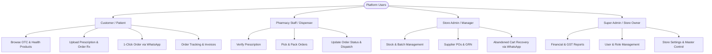
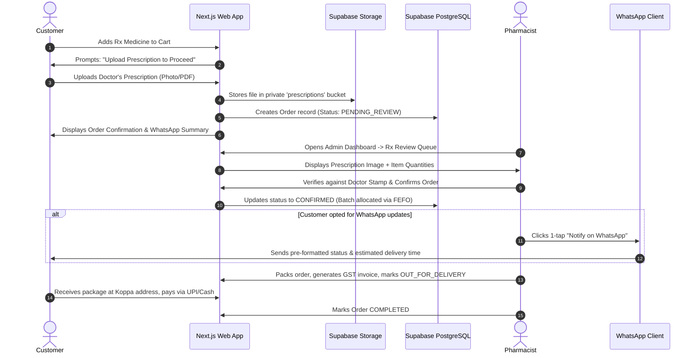
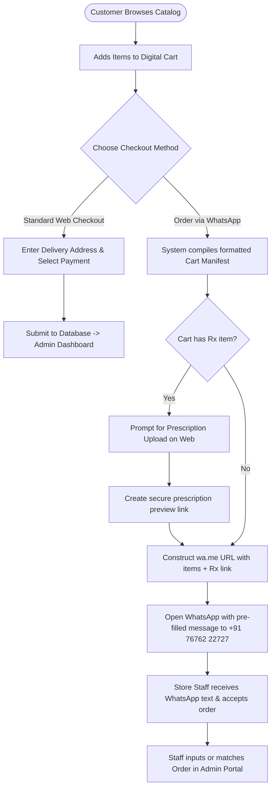
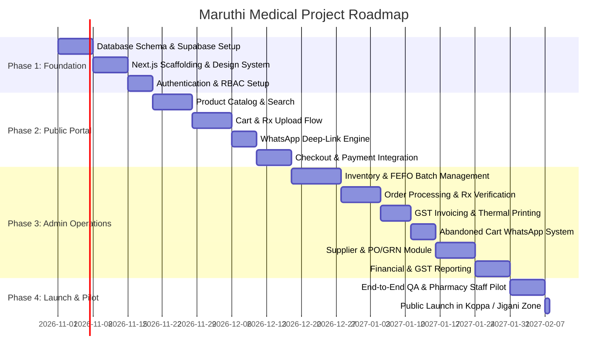

# Product Requirements Document (PRD)
## Maruthi Medical — Next-Gen Pharmacy Commerce & Store Operations Platform

---

### Executive Summary

| Document Info | Details |
| :--- | :--- |
| **Product Name** | Maruthi Medical E-Commerce & Pharmacy ERP Platform |
| **Business Entity** | Maruthi Medical |
| **Physical Location** | Shop no.7, #197/7 & 8, Koppa Village, Hulimangala Post, Jigani Hobli, Anekal Taluk, Bengaluru, Karnataka 560105, India |
| **Primary Contact** | +91 76762 22727 |
| **Target Platforms** | Responsive Web (Mobile-First Customer Portal + Desktop-Optimized Admin Operations Hub) |
| **Core Technology** | Next.js (App Router), TypeScript, Tailwind CSS, Supabase (PostgreSQL, Auth, Storage, Realtime) |
| **Status** | Approved for Architecture & Implementation |

---

### 1. Project Background & Strategic Vision

Maruthi Medical is a trusted, community-rooted retail pharmacy situated in Koppa Village, serving the surrounding residential and industrial belts of Hulimangala, Jigani Hobli, and Anekal Taluk in South Bengaluru. With a strong local reputation (4.8★ rating, open daily until 10:00 PM), the business currently operates primarily via in-person foot traffic and informal phone/WhatsApp queries.

#### 1.1 The Challenge
1. **Friction in Digital Ordering**: Existing online interactions require manual typing of medicine lists over WhatsApp without structured catalogs, resulting in price queries, back-and-forth stock verification, and high drop-off.
2. **Disconnected Inventory**: Retail counters in local pharmacies often face stock mismatches, batch expiration losses, and manual billing delays.
3. **Absence of E-Commerce Capabilities**: Customers in the Koppa/Jigani residential clusters expect instant catalog search, prescription upload, digital cart checkout, and live order tracking.
4. **API Cost Avoidance**: Official WhatsApp Business Cloud API requires meta verification, per-conversation charges, and complex webhooks. The store requires an agile, deep-link based WhatsApp integration that runs completely free of third-party API subscription costs while maintaining high conversion.
5. **Regulatory Compliance**: Indian Drugs and Cosmetics Act (1940) and Pharmacy Practice Regulations mandate clear prescription validation for Schedule H and H1 medications before dispensing.

#### 1.2 The Solution
Build an integrated, enterprise-grade digital platform featuring:
1. **Public E-Commerce & WhatsApp Ordering Portal**: A high-speed, mobile-optimized customer experience allowing instant catalog search, OTC cart checkout, prescription upload for Rx medicines, and zero-cost WhatsApp order generation with formatted cart manifests.
2. **End-to-End Pharmacy Operations & ERP Portal**: A comprehensive, role-gated admin back-office managing multi-batch inventory, expiry tracking, prescription verification queues, order fulfillment pipelines, abandoned cart recovery, supplier procurement, GST-compliant billing, and financial analytics.

---

### 2. User Personas & Target Audiences



#### Persona 1: Suresh (Local Resident / Chronic Patient)
- **Profile**: 52-year-old resident living in Hulimangala; purchases monthly hypertension and diabetes medications.
- **Pain Points**: Forgets monthly refills; dislikes waiting at the counter; wants to send prescription photo quickly.
- **Needs**: Simple prescription upload, one-click re-order, WhatsApp order confirmation, home delivery to Koppa/Jigani.

#### Persona 2: Priya (Working Professional / Parent)
- **Profile**: 31-year-old IT worker commuting via Electronic City / Jigani; needs baby care, OTC wellness, and first-aid supplies.
- **Pain Points**: Needs quick late-evening delivery (store open until 10 PM); prefers browsing prices and adding to cart online.
- **Needs**: Fast mobile search by brand or salt name, transparent stock availability, UPI checkout or COD.

#### Persona 3: Registered Pharmacist / Dispensing Staff
- **Profile**: Full-time pharmacist working counter shifts at Maruthi Medical.
- **Pain Points**: Deciphering messy hand-written prescriptions; tracking batch expiry; fast counter lookups.
- **Needs**: Clear split-screen prescription validation queue, batch selection during packing, barcode/SKU scanning support, quick status update.

#### Persona 4: Store Owner / Super Admin
- **Profile**: Managing partner of Maruthi Medical.
- **Pain Points**: Tracking inventory leakage, expired stock write-offs, GST filing calculations, staff audit logs.
- **Needs**: Consolidated executive dashboard, gross margin reporting, supplier ledger, abandoned cart WhatsApp follow-up tool.

---

### 3. Core Functional Requirements

#### 3.1 Public Customer Portal (Web & Mobile Web)

##### 3.1.1 Product Discovery & Catalog
- **Instant Search**: Debounced search by Brand Name (e.g., "Dolo 650"), Generic Salt/Composition (e.g., "Paracetamol 650mg"), Category, or Manufacturer.
- **Categorization**: 
  - Prescription Medicines (Rx)
  - Over The Counter (OTC) & First Aid
  - Chronic Care (Diabetes, Cardiac, Hypertension)
  - Mother & Baby Care
  - Personal Hygiene & Skin Care
  - Ayurvedic & Herbal Supplements
  - Medical Devices & Wellness Instruments (BP monitors, Nebulizers, Thermometers)
- **Product Details**:
  - Clear "Prescription Required" (Rx) badge with tooltip.
  - Salt composition, form (Tablet, Syrup, Injection, Cream), pack size (e.g., "Strip of 10 tablets").
  - Manufacturer name, MRP, discounted selling price, discount percentage badge.
  - Stock indicator: "In Stock", "Few Left", or "Out of Stock (Notify Me / Inquire via WhatsApp)".

##### 3.1.2 Cart & Checkout Workflow (E-Commerce)
- **Persistent Cart**: Synchronized via local storage and Supabase user session.
- **Rx Gatekeeping**: If the cart contains at least one Rx product, the checkout enforces a "Prescription Step" before payment selection.
- **Prescription Upload Component**:
  - File picker (JPEG, PNG, WEBP, PDF) and native mobile camera capture.
  - Multiple file upload support (up to 5 pages per order).
  - Optional instructions/notes box (e.g., "Dispense 15 days supply instead of 30").
  - Option to select previously uploaded prescriptions from the customer's secure account vault.
- **Delivery Address Handling**:
  - Auto-fill for logged-in users with multiple saved addresses (Home, Office, Other).
  - Geolocation PIN code validation restricted to delivery radius (Primary: 560105, Secondary: 560099, 560100, 562106, 560068 - Koppa, Jigani, Hulimangala, Electronic City Phase 1/2, Anekal).
  - Store pickup option ("Pickup at Koppa Village Counter").
- **Payment Methods**:
  - Cash on Delivery (COD)
  - Pay with UPI on Delivery (Cashier/Rider QR)
  - Razorpay / UPI Gateway (Digital prepay via PhonePe, GooglePay, Paytm, Cards, NetBanking)
  - Pay After Pharmacist Review (for Rx orders where total quantity requires pharmacist confirmation)
- **Order Tracking**:
  - Live progress tracker: `Placed` → `Rx Verified` → `Packed` → `Out for Delivery` → `Delivered`.
  - Shareable public order tracking link using secure UUID token.

##### 3.1.3 WhatsApp Integrated Ordering (No Official API Required)
To eliminate monthly subscription fees and Meta Cloud API overheads, the platform provides deep WhatsApp link workflows:
1. **Direct Cart-to-WhatsApp Generator**:
   - Generates dynamic `https://wa.me/917676222727?text=<ENCODED_MESSAGE>`.
   - Message structure:
     ```text
     *NEW ORDER — MARUTHI MEDICAL*
     ----------------------------------------
     *Order ID:* #MM-8921 (Draft)
     *Customer:* Ramesh Kumar (+91 98765 43210)
     *Address:* Flat 402, Green Meadows, Koppa Gate, 560105
     ----------------------------------------
     *ITEMS:*
     1. Dolo 650mg Strip of 15 (Qty: 2) - ₹64.00
     2. Shelcal 500mg Strip of 15 (Qty: 1) - ₹119.50
     3. Volini Gel 30g (Qty: 1) - ₹125.00
     ----------------------------------------
     *Subtotal:* ₹308.50
     *Estimated Delivery:* Free (Koppa Local)
     *Prescription Attached:* Yes (View: https://maruthimedical.in/rx/view/a8d1-4354)
     ----------------------------------------
     Please confirm availability and dispatch time!
     ```
2. **Direct Rx Upload via WhatsApp**:
   - Customer clicks "Order with Prescription via WhatsApp".
   - Opens WhatsApp with a template: *"Hi Maruthi Medical, I am attaching my prescription photo. Please check availability and calculate total cost for delivery to Koppa Village."*
3. **Pharmacist WhatsApp Consultation Trigger**:
   - Quick inquiry buttons embedded on product pages: *"Ask Pharmacist about this medicine"*.

---

#### 3.2 Admin Back-Office & Pharmacy ERP Portal

##### 3.2.1 Executive Dashboard
- **Real-Time KPI Cards**:
  - Today's Total Sales (Gross & Net Revenue)
  - Total Orders (Online vs WhatsApp vs Counter Walk-in)
  - Pending Prescription Approvals (Alert badge)
  - Critical Low Stock SKUs (< threshold)
  - Expiring Products (within 30 / 60 / 90 days)
- **Visual Analytics**:
  - 7-day and 30-day sales trajectory charts.
  - Top 10 selling medicines & wellness products.
  - Order status distribution (Pie/Bar).
  - Recent live activity stream.

##### 3.2.2 Product Management
- **Full CRUD on Products**:
  - Product Name, Generic Salt / Composition, Brand/Manufacturer.
  - Drug Category, Drug Schedule Type (`OTC`, `Schedule H`, `Schedule H1`, `Schedule X`, `Ayurvedic`).
  - HSN Code (e.g., 3004 for medicaments) & GST Slab (0%, 5%, 12%, 18%).
  - Dosage Form (Tablets, Capsules, Syrup, Ointment, Drops, Inhaler, Powder).
  - Unit of Measure (Strip, Bottle, Tube, Box, Vial).
  - Minimum Safety Stock level & Maximum Reorder level.
  - Rich description, usage directions, side effects, storage warnings.
  - High-resolution product images (Supabase Storage).
  - Active/Inactive toggle and Featured product badge.

##### 3.2.3 Inventory & Batch Management (Pharma-Grade)
- In a pharmacy, stock is tracked per **Batch Number** and **Expiry Date**:
  - Each product has multiple batches: `batch_number`, `manufacturing_date`, `expiry_date`, `mrp`, `purchase_rate`, `sale_rate`, `current_stock_quantity`.
  - **FEFO (First Expired, First Out)** Auto-Allocation: System prioritizes picking the batch closest to expiration while preventing dispensing of expired batches.
  - **Expiry Alert Matrix**:
    - Critical (Expired or < 30 days): Red flag, auto-quarantine toggle.
    - Warning (31 to 90 days): Yellow badge for promotional clearance or return to supplier.
    - Safe (> 90 days): Green.
  - **Stock Adjustment & Audit Logs**:
    - Record damaged stock, broken vials, physical audit variances, and supplier returns with reasons and staff user stamps.
  - **Barcode & SKU Support**:
    - EAN/UPC barcode search for physical counter scanning.

##### 3.2.4 Order Management & Fulfillment Lifecycle
- **Unified Order Status Pipeline**:
  - `PENDING_REVIEW` (Needs prescription check or stock verification)
  - `CONFIRMED` (Rx verified, customer notified)
  - `PACKING` (Batches assigned, invoice generated)
  - `READY_FOR_PICKUP / OUT_FOR_DELIVERY` (Handed over to delivery agent)
  - `COMPLETED` (Delivered & Payment collected)
  - `CANCELLED` (Customer/Admin cancelled with reason)
  - `RETURNED / REFUNDED`
- **Pharmacist Prescription Validation Workspace**:
  - Side-by-side view: Uploaded doctor's prescription image with zoom/pan tools on the left; Order items and dosage adjustment on the right.
  - Pharmacist verification stamp: Doctor name, Patient name, Date of prescription, Pharmacist license ID (`KA-PH-XXXXX`).
  - Ability to edit items or quantities to match the prescription before confirming.
- **GST Tax Invoice Generation**:
  - Compliant with Indian GST rules: Store GSTIN, DL Numbers (Drug License 20B/21B), Customer details, Itemized HSN, Batch number, Expiry date, Taxable value, CGST %, SGST %, Total amount.
  - 1-click Thermal Receipt (3-inch / 80mm) or Standard A4 PDF printing.

##### 3.2.5 Abandoned Cart Management
- **Tracking & Analytics**:
  - Automatic capture of checkout sessions where phone number/email is entered but payment or order submission is not completed within 30 minutes.
  - Metrics: Total abandoned carts, potential lost revenue, recovery conversion rate.
- **Zero-Cost WhatsApp Recovery Action**:
  - Admin/Staff can click "Send WhatsApp Reminder" next to an abandoned cart.
  - Opens WhatsApp Web / Desktop with an optimized message:
    ```text
    Hello [Customer Name], we noticed you left medicines in your cart at Maruthi Medical, Koppa Village. 
    Would you like us to pack them for doorstep delivery today? 
    Click here to complete your order in 1 tap: [Recovery Link]
    ```

##### 3.2.6 Customer Management (CRM)
- Customer profiles aggregated by verified mobile number.
- Customer 360° View: Total orders, lifetime spend, average order value, chronic refill tags (e.g., "Monthly BP - Due on 5th").
- Prescription Repository: Historical doctor prescriptions indexed per customer for fast re-dispensing without re-uploading.
- Internal customer notes (e.g., "Prefers delivery after 6 PM", "Deliver to Koppa Gate security").

##### 3.2.7 Supplier & Purchase Management
- **Supplier Directory**: Distributor name, GSTIN, DL numbers, contact person, phone, payment terms (e.g., 21 days credit, net 30).
- **Purchase Order (PO)** creation: Draft purchase orders based on items below reorder threshold.
- **Goods Receipt Note (GRN) Inwarding**:
  - Inward stock against supplier invoice.
  - Record batch numbers, manufacturing dates, expiry dates, purchase rates, applicable GST, and selling MRP.
  - Auto-updates inventory on GRN completion.
- **Supplier Accounts Payable Ledger**:
  - Track pending invoices, paid amounts, payment mode (NEFT/Cheque/Cash), and due dates.

##### 3.2.8 Financial & GST Reporting
- **Sales Reports**: Daily, weekly, monthly, and custom date range filters.
- **Profitability Metrics**: Gross Profit = Selling Price (excl. tax) - Purchase Rate (excl. tax).
- **GST Statutory Report**:
  - GSTR-1 compliant monthly summary: Total B2C sales, taxable value, CGST collected, SGST collected, split across 0%, 5%, 12%, and 18% slabs.
- **Payment Reconciliation**: Breakdown of cash collected, UPI payments, card transactions, and pending credit balances.

##### 3.2.9 User Management & Role-Based Access Control (RBAC)
- **Super Admin (Store Owner / Managing Partner)**:
  - Unrestricted access: Can view financial reports, configure tax settings, delete records, assign user roles, and manage staff accounts.
- **Admin (Store Manager)**:
  - Inventory management, supplier orders, order lifecycle, pricing adjustments, abandoned cart follow-up. Cannot alter owner financial settings or delete audit logs.
- **Staff (Pharmacist / Counter Cashier)**:
  - Prescription verification, picking & packing, counter sales entry, order status updates, delivery dispatch. Restricted from viewing supplier purchase costs and overall financial net profits.

---

### 4. Regulatory & Compliance Requirements (India Pharma)

| Regulation / Standard | Platform Requirement | Implementation in Maruthi Medical |
| :--- | :--- | :--- |
| **Drugs and Cosmetics Act, 1940 & Rules 1945** | Prohibits dispensing Schedule H, H1, and X drugs without a valid physical or digital prescription from a Registered Medical Practitioner (RMP). | System tags all Schedule H/H1 medicines with mandatory Rx flag; checkout blocks order confirmation without prescription verification. |
| **Pharmacy Practice Regulations (PCI)** | Dispensing must be supervised and audited by a Registered Pharmacist holding a valid State Pharmacy Council license. | System requires the logged-in Pharmacist's ID and license number recorded on the digital order verification log. |
| **Drug License Display (Form 20B & 21B)** | Mandatory display of retail Drug License numbers on invoices, web portal, and store receipts. | Fixed footer in customer portal and mandatory header on all generated GST tax invoices and thermal receipts. |
| **GST Act (HSN Compliance)** | Specific HSN codes (3003, 3004, 3005, 3006) with correct dual-tax splitting (CGST + SGST). | Database schema stores HSN code and GST percentage per product; tax engine automatically calculates dual split. |
| **Data Privacy (DPDP Act 2023)** | Protection of personal medical records, sensitive health information, and doctor prescriptions. | Supabase Storage configured with private access policies; prescription assets served solely via short-lived signed URLs. |

---

### 5. Non-Functional Requirements (NFRs)

#### 5.1 Performance & Core Web Vitals
- **Lighthouse Score**: > 90 across Performance, Accessibility, Best Practices, and SEO.
- **Catalog Load Time**: First Contentful Paint (FCP) < 1.2s; Largest Contentful Paint (LCP) < 2.2s on 4G mobile networks.
- **Search Latency**: Search results rendered in < 150ms using debounced client-side filtering combined with indexed Supabase Full-Text Search.

#### 5.2 Security & Data Protection
- **Row Level Security (RLS)**: Enforced on all Supabase PostgreSQL tables; customers can strictly view only their own orders and prescriptions; staff access bounded by RBAC claims.
- **Prescription Media Security**: Prescriptions uploaded to a private Supabase Storage bucket with RLS; never publicly accessible via static URL.
- **Authentication**: Supabase Auth with Secure Mobile OTP (SMS) or Magic Link / Password login, supporting persistent guest sessions.

#### 5.3 Reliability & Scalability
- **Uptime**: 99.9% availability hosted on Vercel Edge Network paired with Supabase Managed PostgreSQL.
- **Data Backups**: Daily automated PostgreSQL backups with Point-In-Time Recovery (PITR).
- **Offline / Low-Connectivity Tolerance**: Public mobile site service worker caching static assets; gracefully displays contact numbers and WhatsApp direct fallbacks if connectivity drops.

---

### 6. User Journeys & Workflow Diagrams

#### 6.1 Online Prescription Order Workflow



#### 6.2 Instant WhatsApp Checkout Workflow (Zero API Cost)



---

### 7. Success Metrics & KPIs

| Metric | Baseline (Current) | 90-Day Target Post-Launch | 180-Day Target |
| :--- | :--- | :--- | :--- |
| **Digital Monthly Orders** | ~15 orders/month (informal phone calls) | 250+ orders/month | 800+ orders/month |
| **Average Order Value (AOV)** | ₹220 | ₹450 (driven by OTC bundles & chronic refills) | ₹550 |
| **Prescription Verification Time** | Manual 2-3 hours | < 15 minutes during operating hours | < 10 minutes |
| **Abandoned Cart Recovery Rate** | 0% (untracked) | 18% recovered via 1-click WhatsApp follow-up | 25% |
| **Inventory Shrinkage / Expiry Loss** | ~4-6% annual loss | < 1.5% through FEFO alerts & 60-day expiry warning | < 0.8% |
| **Customer Retention (Chronic Care)** | Informal | 40% repeat orders via automated refill reminders | 60% |

---

### 8. Milestone & Implementation Roadmap



---
*End of Product Requirements Document (PRD)*
